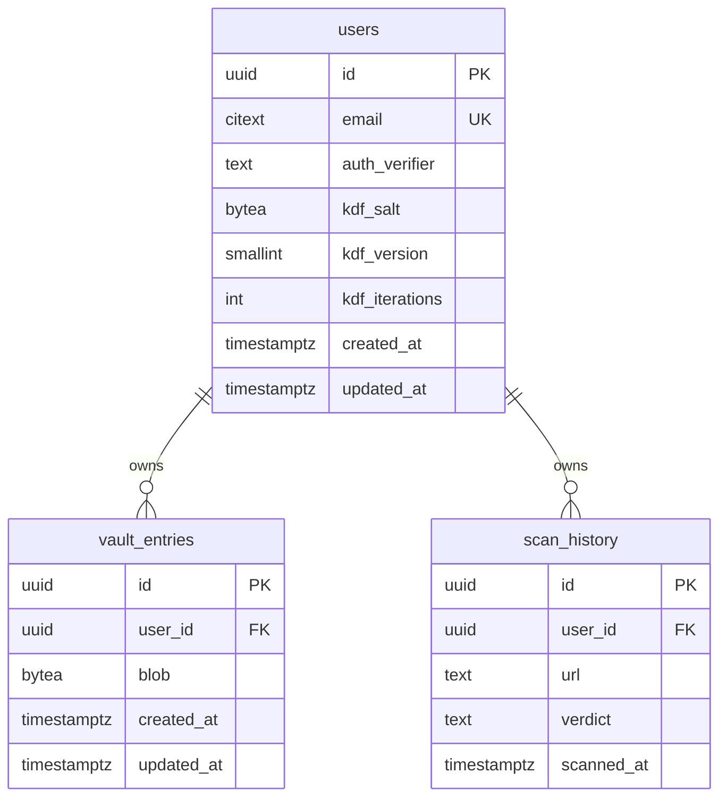
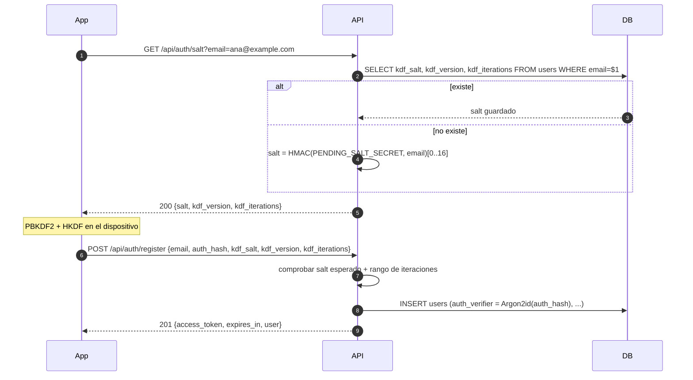
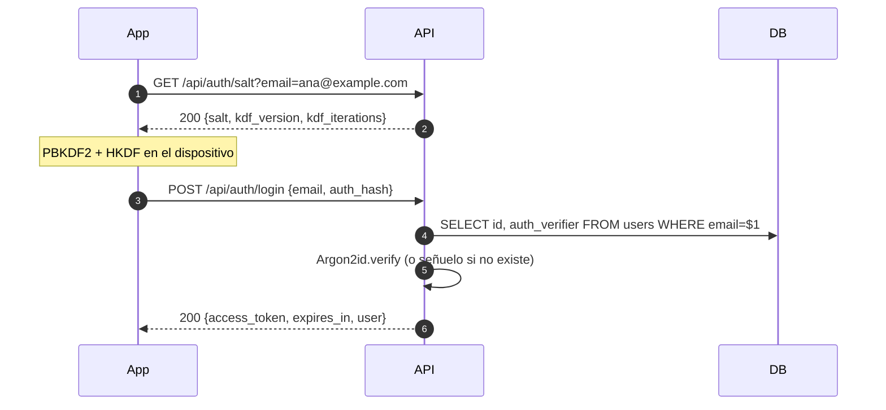

# BACKEND.md — Contrato y guía del backend de SecureUP

> **Estado:** copia de referencia, 2026-11-12. La versión canónica vive en el repositorio del backend (`secureup-backend`); si las dos difieren, manda esa.
> **Alcance:** contrato de la API REST que esta app consume, para que el equipo conozca qué esperar y los DTOs no cambien sin aviso.
>
> **Fuente de verdad del lado app:** `AGENTS.md` §6 (seguridad) y §7 (diseño criptográfico y de API). Si el contrato canónico contradice `AGENTS.md`, hay que corregir el contrato y avisar al equipo del backend.
>
> **Este archivo no contiene secretos.** La API key de Safe Browsing, el secreto JWT y la contraseña de la base van en variables de entorno del servidor. Si alguna vez pegas una clave real aquí o en cualquier archivo del repo, **rótala de inmediato** en Google Cloud.

---

## 0. Cómo usar este documento

- Léelo completo antes de escribir código del backend.
- Los nombres de campos, rutas y variables van en inglés; la documentación y los mensajes de error para el usuario final, en español.
- No agregues endpoints, campos ni dependencias que no estén aquí sin actualizar este archivo y avisar al equipo de la app.
- Los ejemplos con `...` o `<...>` son marcadores: no son valores válidos para autenticarse.
- La app es la única que deriva claves y cifra. El backend **nunca** ve la contraseña maestra, la `vaultKey` ni el contenido en claro de la bóveda.

---

## 1. Qué debe hacer el backend (y qué no)

### Dentro del alcance

1. Registrar usuarios y autenticarlos con `auth_hash` (nunca con la contraseña maestra).
2. Emitir y verificar JWT de vida corta.
3. Guardar, listar, actualizar y borrar blobs cifrados de la bóveda, sin poder descifrarlos.
4. Verificar URLs contra Google Safe Browsing (proxy con la API key en el servidor).
5. Eliminar la cuenta y sus datos en cascada (endpoint pendiente de decisión de diseño).
6. Servir todo por HTTPS.

### Fuera del alcance

- Descifrar la bóveda o guardar la contraseña maestra.
- Sincronización en tiempo real, notificaciones push, biometría.
- Moderación, panel web, iOS.
- Historial de escaneos compartido entre dispositivos: esta entrega lo guarda solo en Room, en el teléfono. La tabla `scan_history` queda reservada, sin uso todavía.

### Relación con los pasos de la app

| Paso de `AGENTS.md` | Estado | Qué necesita del backend |
|---|---|---|
| 4. `CryptoManager` | Hecho | Nada. Ya existe en la app. |
| 5. Bóveda | Pospuesto a 26.3.1 | CRUD de blobs + esquema de re-cifrado. |
| 6. Retrofit + `AuthRepository` real | Pendiente | `GET /salt`, `POST /register`, `POST /login`. |
| 7. Brecha (HIBP) | Hecho directo desde la app | Nada. Excepción aprobada el 2026-11-09: HIBP no usa clave y la app envía solo el prefijo de 5 caracteres del SHA-1. El endpoint `POST /api/breach-check` **no se implementa**. |
| 8. Escáner QR | En curso | `POST /api/qr-check` (Safe Browsing). |
| 9. Perfil | Parcial (logout hecho) | Cambio de contraseña maestra (26.3.1) y eliminar cuenta (pendiente). |

---

## 2. Stack recomendado

No hay decisión cerrada en `AGENTS.md`. Para un proyecto universitario con un solo servidor, esta es la ruta con menos fricción:

| Pieza | Recomendación | Alternativa válida | Por qué |
|---|---|---|---|
| Runtime | **Node.js LTS** (22 o la LTS vigente) | Kotlin + Ktor, Python + FastAPI | Ecosistema maduro para JWT, Argon2 y PostgreSQL; despliegue simple. |
| Framework | **Express 5** | Fastify | Curva de aprendizaje baja y suficiente para 10 endpoints. |
| Base de datos | **PostgreSQL 16+** | MySQL 8 | `CITEXT`, `BYTEA`, UUID nativo, transacciones sólidas. |
| Driver | `pg` (pool) | — | Directo, sin ORM que esconda el SQL. |
| Validación | `zod` | `joi` | Valida y documenta el contrato en un solo lugar. |
| Hash de `auth_hash` | **Argon2id** (`@node-rs/argon2` o `argon2`) | bcrypt (coste ≥ 12) | Recomendación OWASP; sin límite de 72 bytes. |
| JWT | `jose` (o `jsonwebtoken`) | — | HS256 con secreto de 32 bytes; algoritmos permitidos explícitos. |
| Logs | `pino` + `pino-http` | `winston` | JSON, redacción de campos sensibles. |
| Rate limit | `express-rate-limit` + `limit_req` de nginx | Solo nginx | Dos capas baratas. |
| Despliegue | Docker Compose (api + postgres) | systemd + binario | Reproducible y fácil de reiniciar. |

> Si el equipo prefiere Kotlin/Ktor para no cambiar de lenguaje, es válido; mantén **exactamente** el mismo contrato de la sección 5 y los parámetros de la sección 4.

### Estructura sugerida del repo `secureup-backend`

```
secureup-backend/
├── src/
│   ├── app.js                 # express, middlewares, rutas
│   ├── server.js              # arranque y cierre ordenado
│   ├── config/env.js          # lee y valida variables de entorno
│   ├── db/
│   │   ├── pool.js            # pg.Pool
│   │   └── migrations/        # SQL versionado (001_init.sql, ...)
│   ├── middleware/
│   │   ├── auth.js            # verifica JWT
│   │   ├── errorHandler.js    # formato único de error
│   │   ├── rateLimit.js
│   │   └── validate.js        # zod
│   ├── routes/
│   │   ├── auth.routes.js
│   │   ├── vault.routes.js
│   │   ├── qr.routes.js
│   │   └── account.routes.js
│   └── services/
│       ├── auth.service.js
│       ├── vault.service.js
│       └── safeBrowsing.service.js
├── test/
├── scripts/
│   └── derive-test-keys.js
├── .env.example
├── .gitignore
├── docker-compose.yml
├── Dockerfile
└── README.md
```

`.gitignore` mínimo: `.env`, `node_modules/`, `coverage/`, `*.log`, `dist/`.

---

## 3. Modelo de datos

### Diagrama



### SQL de inicialización

```sql
CREATE EXTENSION IF NOT EXISTS citext;

CREATE TABLE users (
    id              UUID PRIMARY KEY DEFAULT gen_random_uuid(),
    email           CITEXT NOT NULL UNIQUE,
    -- Argon2id(auth_hash). NUNCA el auth_hash en claro.
    auth_verifier   TEXT NOT NULL,
    kdf_salt        BYTEA NOT NULL CHECK (octet_length(kdf_salt) >= 16),
    kdf_version     SMALLINT NOT NULL,
    kdf_iterations  INTEGER NOT NULL
                    CHECK (kdf_iterations BETWEEN 600000 AND 3000000),
    created_at      TIMESTAMPTZ NOT NULL DEFAULT now(),
    updated_at      TIMESTAMPTZ NOT NULL DEFAULT now()
);

CREATE TABLE vault_entries (
    id          UUID PRIMARY KEY,              -- generado en la app (v4)
    user_id     UUID NOT NULL REFERENCES users(id) ON DELETE CASCADE,
    -- [0x01][nonce 12][ciphertext + tag 16]. El servidor no lo interpreta.
    blob        BYTEA NOT NULL CHECK (octet_length(blob) BETWEEN 29 AND 4096),
    created_at  TIMESTAMPTZ NOT NULL DEFAULT now(),
    updated_at  TIMESTAMPTZ NOT NULL DEFAULT now()
);
CREATE INDEX vault_entries_user_id_idx ON vault_entries (user_id);

-- Reservada. Esta entrega NO la usa: el historial vive en Room, en el teléfono.
CREATE TABLE scan_history (
    id          UUID PRIMARY KEY DEFAULT gen_random_uuid(),
    user_id     UUID NOT NULL REFERENCES users(id) ON DELETE CASCADE,
    url         TEXT NOT NULL,
    verdict     TEXT NOT NULL CHECK (verdict IN ('SAFE', 'SUSPICIOUS', 'DANGEROUS')),
    scanned_at  TIMESTAMPTZ NOT NULL DEFAULT now()
);
CREATE INDEX scan_history_user_scanned_idx
    ON scan_history (user_id, scanned_at DESC);
```

### Notas del esquema

- `email` se normaliza a `trim().toLowerCase()` antes de guardar y comparar; `CITEXT` ya ignora mayúsculas.
- `auth_verifier` es la cadena PHC que produce Argon2id, por ejemplo `$argon2id$v=19$m=19456,t=2,p=1$...`.
- `kdf_salt` es el salt **del cliente** para PBKDF2. No es secreto, pero es único por usuario.
- `vault_entries.id` lo genera la app porque es el **AAD** del cifrado AES-GCM. El servidor no puede cambiarlo ni regenerarlo: si lo hiciera, el blob quedaría indescifrable.
- Todas las consultas de bóveda filtran por `id` **y** `user_id`. Un usuario no puede leer ni borrar entradas de otro (IDOR).
- `ON DELETE CASCADE` garantiza que borrar la cuenta elimina bóveda e historial.
- Límites: máximo 500 entradas por usuario y 4 KB por blob. Se validan en la aplicación además del `CHECK`.

---

## 4. Criptografía y autenticación (contrato con la app)

### 4.1 Derivación en el cliente (ya implementada en `CryptoManager`)

```
password_nfc = NFC(contraseña_maestra)
masterKey    = PBKDF2-HMAC-SHA256(password_nfc, kdf_salt, kdf_iterations, 32 bytes)
authHash     = HMAC-SHA256(masterKey, "secureup-auth-v1"  || 0x01)
vaultKey     = HMAC-SHA256(masterKey, "secureup-vault-v1" || 0x01)
```

- `kdf_version = 1` es la única versión implementada.
- `kdf_iterations` debe estar en `[600000, 3000000]`. El cliente rechaza valores fuera de rango aunque vengan del servidor.
- `authHash` y `vaultKey` son 32 bytes.
- `vaultKey` **nunca** se envía. `authHash` se envía una vez por login y se borra de memoria al terminar.
- El blob de una entrada es `[0x01][nonce 12 bytes][ciphertext + tag 16 bytes]`; el AAD es el UUID de la entrada codificado en UTF-8.

### 4.2 Qué guarda el servidor

1. Recibe `auth_hash` en base64 (32 bytes exactos).
2. Lo hashea con **Argon2id** y guarda el resultado en `auth_verifier`.
3. Nunca guarda `auth_hash` en claro, ni lo loguea.

Parámetros Argon2id (mínimo OWASP):

```
type: argon2id
memoryCost: 19456 KiB (19 MiB)
timeCost: 2
parallelism: 1
hashLength: 32
```

En login: `argon2.verify(auth_verifier, authHashBytes)`. Si el usuario no existe, verifica igualmente contra un verificador señuelo generado al arrancar, para no filtrar por tiempo si el correo está registrado. Responde siempre `401 INVALID_CREDENTIALS` genérico.

> **Por qué no se guarda `auth_hash` tal cual:** si se filtra la base, ese valor sirve para autenticarse directamente (*pass-the-hash*) sin conocer la contraseña maestra. Con Argon2id encima, el atacante necesita romper un hash costoso.

### 4.3 Salt: cómo se elige

El servidor es quien decide el salt, nunca el cliente. Regla:

- **Correo ya registrado** → devuelve `users.kdf_salt`, `kdf_version`, `kdf_iterations` guardados.
- **Correo no registrado** → salt determinista y estable:
  ```
  salt = first16( HMAC-SHA256(PENDING_SALT_SECRET, "secureup-pending-salt-v1" || email_normalizado) )
  ```
  No se guarda en la base. Al registrarse, el servidor lo recalcula y comprueba que coincide con el que envió el cliente.
- Así, dos llamadas seguidas al mismo correo desconocido devuelven el mismo salt, y la respuesta tiene la misma forma que la de un usuario real: **no se puede enumerar cuentas** por la respuesta ni por el tiempo.
- `PENDING_SALT_SECRET` es un secreto de 32 bytes en el entorno. Rotarlo solo afecta a registros a medio hacer; las cuentas existentes conservan su salt guardado.

### 4.4 Flujo de registro



El registro devuelve token para no obligar a la app a hacer **dos** derivaciones PBKDF2 (600 000 iteraciones en un teléfono son caras).

### 4.5 Flujo de login



### 4.6 JWT

- Algoritmo: **HS256** con `JWT_SECRET` de al menos 32 bytes aleatorios (`openssl rand -base64 32`).
- Claims: `sub` (UUID del usuario), `iss` = `secureup-api`, `aud` = `secureup-app`, `iat`, `exp`.
- Vida: **30 minutos**. No hay refresh token en esta versión: al expirar, la app vuelve a pedir la contraseña maestra y hace login. Eso es coherente con que la `vaultKey` solo vive en RAM.
- Verificación: algoritmo permitido explícito (`HS256`), `issuer` y `audience` comprobados; token expirado → `401 TOKEN_EXPIRED`.
- El token no contiene email ni datos sensibles, solo `sub`.
- Rotar `JWT_SECRET` cierra todas las sesiones; es aceptable y está documentado.

---

## 5. API REST

### 5.1 Convenciones

- Base: `https://<host>/api`. No hay versionado en la ruta por ahora.
- Cuerpo y respuesta: `application/json; charset=utf-8`.
- Autenticación: `Authorization: Bearer <jwt>` en todos los endpoints salvo `GET /api/auth/salt`, `POST /api/auth/register`, `POST /api/auth/login` y `GET /health`.
- Fechas: ISO 8601 UTC (`2026-11-09T18:04:00Z`).
- Binarios: base64 estándar (no URL-safe), con padding.
- Límite de cuerpo: 1 MB general; 5 MB en el re-cifrado completo de la bóveda.
- Cada request lleva `X-Request-Id` (lo genera el servidor si no viene) y se devuelve en la respuesta para depurar sin exponer datos.

Formato único de error:

```json
{
  "error": {
    "code": "INVALID_CREDENTIALS",
    "message": "Credenciales incorrectas",
    "request_id": "4f1c2a7e-..."
  }
}
```

`message` es para depurar; la app traduce `code` a un texto de `strings.xml`.

Códigos usados:

| HTTP | `code` | Cuándo |
|---|---|---|
| 400 | `VALIDATION_ERROR` | JSON inválido, campo faltante, formato incorrecto. |
| 401 | `INVALID_CREDENTIALS` | Email o `auth_hash` incorrectos (mensaje genérico). |
| 401 | `TOKEN_EXPIRED` | JWT vencido. La app debe volver a desbloquear. |
| 401 | `INVALID_TOKEN` | JWT ausente, malformado o con firma inválida. |
| 404 | `NOT_FOUND` | Recurso inexistente **o de otro usuario** (no revelar cuál). |
| 409 | `EMAIL_TAKEN` | Registro con correo ya existente. |
| 409 | `SALT_CHANGED` | El salt recalculado no coincide con el enviado; repetir el flujo. |
| 409 | `VAULT_LIMIT_REACHED` | Más de 500 entradas. |
| 413 | `PAYLOAD_TOO_LARGE` | Cuerpo o blob demasiado grande. |
| 429 | `RATE_LIMITED` | Demasiadas peticiones; incluye `Retry-After`. |
| 503 | `UPSTREAM_UNAVAILABLE` | Google Safe Browsing no respondió. |
| 500 | `INTERNAL_ERROR` | Fallo no previsto; nunca devolver stack trace. |

### 5.2 Resumen de endpoints

| Método | Ruta | Auth | Estado |
|---|---|---|---|
| GET | `/health` | No | Ops |
| GET | `/api/auth/salt` | No | Necesario |
| POST | `/api/auth/register` | No | Necesario |
| POST | `/api/auth/login` | No | Necesario |
| GET | `/api/vault` | Sí | 26.3.1 |
| POST | `/api/vault` | Sí | 26.3.1 |
| PUT | `/api/vault/{id}` | Sí | 26.3.1 |
| DELETE | `/api/vault/{id}` | Sí | 26.3.1 |
| PUT | `/api/vault` (re-cifrado) | Sí | Propuesta 26.3.1 |
| POST | `/api/qr-check` | Sí | Entrega actual |
| DELETE | `/api/account` | Sí | Pendiente de diseño |

---

### 5.3 `GET /health`

Sin autenticación. No consulta la base ni expone versiones internas.

```json
{ "status": "ok", "uptime_seconds": 1234 }
```

---

### 5.4 `GET /api/auth/salt?email=ana@example.com`

- Valida el correo (máximo 254 caracteres).
- Respuesta idéntica exista o no el usuario (ver §4.3).
- `Cache-Control: no-store`.

```json
{
  "salt": "q83v9S2m4Yh0K1pQ7rT5uA==",
  "kdf_version": 1,
  "kdf_iterations": 600000
}
```

Errores: `400 VALIDATION_ERROR`, `429 RATE_LIMITED`.

---

### 5.5 `POST /api/auth/register`

```json
{
  "email": "ana@example.com",
  "auth_hash": "<base64 de 32 bytes>",
  "kdf_salt": "<base64 de 16 bytes, el que devolvió /salt>",
  "kdf_version": 1,
  "kdf_iterations": 600000
}
```

Validaciones:

- `auth_hash`: base64 válido que decodifique a **32 bytes**.
- `kdf_salt`: base64 válido que decodifique a **16 bytes** y coincida con el esperado (§4.3).
- `kdf_version` = `1`.
- `kdf_iterations` en `[600000, 3000000]`; se guarda el valor enviado (el mínimo, 600 000, es el recomendado OWASP actual).
- Correo con formato válido y no registrado.

Respuesta `201`:

```json
{
  "access_token": "<jwt>",
  "token_type": "Bearer",
  "expires_in": 1800,
  "user": { "id": "9b2f4c1e-7a3d-4e5f-8c6b-1d2e3f4a5b6c", "email": "ana@example.com" }
}
```

Errores: `400`, `409 EMAIL_TAKEN`, `409 SALT_CHANGED`, `429`.

---

### 5.6 `POST /api/auth/login`

```json
{ "email": "ana@example.com", "auth_hash": "<base64 de 32 bytes>" }
```

Respuesta `200`: mismo cuerpo que el registro.

Errores: `400`, `401 INVALID_CREDENTIALS` (siempre el mismo mensaje, exista o no el correo), `429`.

---

### 5.7 Bóveda

Todas las rutas exigen JWT. El servidor no interpreta `blob`; solo valida longitud y propiedad.

#### `GET /api/vault`

```json
{
  "entries": [
    {
      "id": "3f1c9a52-7d4e-4b8a-9c21-5e6f7a8b9c0d",
      "blob": "<base64>",
      "updated_at": "2026-11-09T18:10:00Z"
    }
  ],
  "count": 1,
  "max_entries": 500
}
```

#### `POST /api/vault`

```json
{ "id": "3f1c9a52-7d4e-4b8a-9c21-5e6f7a8b9c0d", "blob": "<base64>" }
```

- `id`: UUID v4 generado por la app. Si ya existe para ese usuario → `409` (la app debe usar `PUT`).
- `blob`: 29–4096 bytes al decodificar.
- Respuesta `201` con `{id, updated_at}`.

#### `PUT /api/vault/{id}`

```json
{ "blob": "<base64>" }
```

Respuesta `200` con `{id, updated_at}`. Si la entrada no existe **o es de otro usuario** → `404 NOT_FOUND`.

#### `DELETE /api/vault/{id}`

Respuesta `204`, sin cuerpo. Si no existe o es de otro usuario → `404`.

#### Re-cifrado completo (propuesta para 26.3.1, pendiente de confirmar)

Al cambiar la contraseña maestra, la app descifra todo con la clave vieja, vuelve a cifrar con la nueva y sube el vault completo en **una sola transacción atómica**:

```json
{
  "current_auth_hash": "<base64 de 32 bytes>",
  "new_auth_hash": "<base64 de 32 bytes>",
  "new_kdf_salt": "<base64 de 16 bytes>",
  "new_kdf_version": 1,
  "new_kdf_iterations": 600000,
  "entries": [
    { "id": "3f1c9a52-...", "blob": "<base64>" }
  ]
}
```

En una transacción: verificar `current_auth_hash`, actualizar `auth_verifier`, `kdf_salt` y parámetros, borrar las entradas que ya no estén y hacer upsert de las nuevas. Si algo falla, rollback completo. **No implementar hasta confirmar el contrato con la app.**

---

### 5.8 `POST /api/qr-check`

Requiere JWT.

```json
{ "url": "https://example.com/login" }
```

Validación de la URL (nunca se visita, solo se envía a Google):

- Máximo 2048 caracteres, sin espacios ni saltos de línea.
- Esquema `http` o `https`; cualquier otro → `400`.
- Sin usuario/contraseña embebidos (`https://banco.com@malicioso.com`).
- Se normaliza con `new URL()`; si no parsea → `400`.

Respuesta `200`:

```json
{
  "verdict": "DANGEROUS",
  "threats": ["SOCIAL_ENGINEERING"],
  "checked_at": "2026-11-09T18:04:00Z",
  "cached": false
}
```

```json
{
  "verdict": "SAFE",
  "threats": [],
  "checked_at": "2026-11-09T18:04:00Z",
  "cached": true
}
```

- `SAFE` significa **"sin amenazas conocidas"**, no "sitio verificado". La app combina esto con su análisis heurístico local (`UrlAnalyzer`).
- `DANGEROUS` si hay cualquier coincidencia; `threats` lista los tipos (`MALWARE`, `SOCIAL_ENGINEERING`, `UNWANTED_SOFTWARE`, `POTENTIALLY_HARMFUL_APPLICATION`).
- `503 UPSTREAM_UNAVAILABLE` si Safe Browsing falla o tarda más de 3 s; la app mantiene el veredicto heurístico y avisa que no se pudo verificar.

Caché: clave `SHA-256(url)`, TTL 5 minutos para resultados seguros y el `cacheDuration` que devuelva Google para los peligrosos (mínimo 5 minutos). Con una sola instancia basta un TTL en memoria; si algún día hay varias, mover a tabla o Redis.

---

### 5.9 `DELETE /api/account` (pendiente de diseño)

Propuesta: exigir JWT **y** `{ "auth_hash": "<base64>" }` para confirmar la contraseña maestra, borrar el usuario y dejar que `ON DELETE CASCADE` limpie bóveda e historial. Respuesta `204`. No implementar hasta que el diseño de Perfil lo apruebe.

---

## 6. Google Safe Browsing

### 6.1 Clave

- Se obtiene en Google Cloud Console: proyecto propio → habilitar **Safe Browsing API** → Credenciales → clave de API.
- Restricciones obligatorias:
  - **Restricción de API:** solo Safe Browsing API.
  - **Restricción de aplicación:** direcciones IP → la **Elastic IP** de la instancia EC2. No la dejes sin restricción.
- Variable de entorno: `SAFE_BROWSING_API_KEY`. Nunca en el repo, nunca en `local.properties` de la app, nunca en el APK.
- La API es **gratuita y solo para uso no comercial**; un proyecto universitario cumple. Si algún día se cobra por la app, hay que migrar a **Web Risk**.
- La cuota por defecto se consulta en la consola (APIs y servicios → Safe Browsing API → Cuotas). No asumas un número: míralo ahí. Se puede pedir aumento.

### 6.2 Llamada (v4 Lookup)

```
POST https://safebrowsing.googleapis.com/v4/threatMatches:find?key=<API_KEY>
Content-Type: application/json
```

```json
{
  "client": { "clientId": "secureup", "clientVersion": "1.0.0" },
  "threatInfo": {
    "threatTypes": [
      "MALWARE",
      "SOCIAL_ENGINEERING",
      "UNWANTED_SOFTWARE",
      "POTENTIALLY_HARMFUL_APPLICATION"
    ],
    "platformTypes": ["ANY_PLATFORM"],
    "threatEntryTypes": ["URL"],
    "threatEntries": [{ "url": "https://example.com/login" }]
  }
}
```

- Sin coincidencias → `200` con cuerpo `{}`.
- Con coincidencias → `200` con `matches[]` y `cacheDuration`.
- Se puede enviar hasta 500 URLs por petición; aquí se envía una.

> v4 es la versión estable y más simple (JSON, una llamada). Existe v5 (`hashes:search`, `urls:search` en alfa) pensada para listas locales y modo tiempo real; no hace falta para este proyecto. Si Google anuncia el apagado de v4, migrar manteniendo el mismo contrato interno de `/api/qr-check`.

### 6.3 Obligaciones de la API que afectan a la app

La documentación de uso exige:

1. Lenguaje calificado en las advertencias: "posible", "sospechoso", "puede ser", nunca "es malicioso" como certeza.
2. Atribución visible: **"Advisory provided by Google"** con enlace a <https://developers.google.com/safe-browsing/v4/advisory>.
3. Aviso de que hay falsos positivos y falsos negativos.

Estos textos son requisito legal de la API, pero **no están en `DESIGN.md`**: hay que confirmarlos con el diseño antes de escribirlos en `strings.xml`.

---

## 7. Seguridad

### 7.1 Reglas no negociables

- HTTPS en todo el tráfico. El puerto 5432 no se expone a internet. Sin HTTP en claro.
- `auth_hash` nunca en claro en la base ni en logs; `auth_verifier` con Argon2id.
- No loggear: contraseñas, `auth_hash`, tokens, `Authorization`, blobs, ni URLs completas. Para depurar una URL, guardar su SHA-256.
- No devolver stack traces ni mensajes internos.
- Consultas SQL siempre parametrizadas (`$1`, `$2`); prohibido concatenar.
- Comparaciones de secretos con `crypto.timingSafeEqual`.
- Errores de login genéricos y verificación señuelo para correos inexistentes.
- Límites de tamaño y de tasa antes de tocar la base o Google.
- Dependencias auditadas (`npm audit --omit=dev`) y versiones fijadas en `package-lock.json`.

### 7.2 Rate limits sugeridos

| Endpoint | Límite |
|---|---|
| `GET /api/auth/salt` | 10/min por IP |
| `POST /api/auth/register` | 5/hora por IP |
| `POST /api/auth/login` | 10/min por IP + retraso progresivo |
| `GET/POST/PUT/DELETE /api/vault` | 120/min por usuario |
| `POST /api/qr-check` | 20/min por usuario |
| `DELETE /api/account` | 3/hora por usuario |

Responde `429` con `Retry-After`. Si hay proxy inverso, configura `app.set('trust proxy', 1)` para leer la IP real de `X-Forwarded-For` sin confiar en cabeceras arbitrarias.

### 7.3 Logs

- `pino` con `redact`: `req.headers.authorization`, `req.body.auth_hash`, `req.body.current_auth_hash`, `req.body.new_auth_hash`, `req.body.blob`, `req.body.password`.
- Registra método, ruta, estado, duración y `request_id`; no el cuerpo.
- Nivel `info` en producción; `debug` solo local y nunca con cuerpos de auth/vault.

### 7.4 Base de datos

- Usuario de aplicación sin privilegios de superusuario: solo `SELECT/INSERT/UPDATE/DELETE` en sus tablas.
- Migraciones con un usuario distinto o con permisos temporales.
- Copias de seguridad diarias con `pg_dump`, comprimidas y cifradas; retención 7 diarias / 4 semanales / 12 mensuales como mínimo.
- Aunque la base solo tenga hashes y blobs cifrados, sigue siendo sensible.

### 7.5 Modelo de amenazas resumido

| Amenaza | Mitigación |
|---|---|
| Filtración de la base | `auth_verifier` con Argon2id; blobs cifrados con clave que no está en el servidor. |
| Servidor malicioso o comprometido | No puede derivar `vaultKey` desde `auth_hash` (etiquetas HKDF distintas); el cliente valida iteraciones. |
| Robo de JWT | Vida corta (30 min), TLS, almacenamiento cifrado en la app; el atacante no puede descifrar la bóveda. |
| Enumeración de cuentas | Salt estable para correos desconocidos + errores genéricos + tiempos uniformes. |
| IDOR | Toda consulta filtra por `user_id`; `404` en vez de `403`. |
| Fuerza bruta | Rate limit + Argon2id + contraseña maestra de 12+ caracteres. |
| Intercambio de blobs | AAD = UUID de la entrada; GCM falla al descifrar. |
| Abuso de cuota de Google | Caché + rate limit + clave restringida por IP. |

---

## 8. Despliegue en EC2

### 8.1 Infraestructura

- Ubuntu 24.04 LTS, `t3.micro` o similar, **Elastic IP** (necesaria para restringir la API key).
- Security group:
  - `22/tcp` solo desde la IP del equipo.
  - `80/tcp` y `443/tcp` desde `0.0.0.0/0`.
  - **Nada más**.
- Docker + Docker Compose.
- nginx como proxy inverso y terminación TLS.
- Certificado con Let's Encrypt (`certbot`), renovación automática.

### 8.2 Pasos

```bash
sudo apt update
sudo apt install -y docker.io docker-compose-v2 nginx certbot python3-certbot-nginx
sudo systemctl enable --now docker nginx
```

1. Clona el repo del backend en `/opt/secureup-backend`.
2. Crea `/opt/secureup-backend/.env` con permisos `600`, dueño del usuario del servicio.
3. `docker compose up -d --build`.
4. Configura nginx con `client_max_body_size 6m` y `proxy_pass http://127.0.0.1:8080`.
5. `sudo certbot --nginx -d api.tudominio.com`.
6. Verifica `curl https://api.tudominio.com/health`.

`docker-compose.yml` de referencia:

```yaml
services:
  api:
    build: .
    restart: unless-stopped
    env_file: .env
    ports:
      - "127.0.0.1:8080:8080"
    depends_on:
      - db

  db:
    image: postgres:16-alpine
    restart: unless-stopped
    environment:
      POSTGRES_DB: secureup
      POSTGRES_USER: secureup
      POSTGRES_PASSWORD: ${DB_PASSWORD}
    volumes:
      - pgdata:/var/lib/postgresql/data
    # Sin "ports": la base no se expone fuera de la red de Docker.

volumes:
  pgdata:
```

nginx (resumen):

```nginx
server {
    listen 80;
    server_name api.tudominio.com;
    return 301 https://$host$request_uri;
}

server {
    listen 443 ssl http2;
    server_name api.tudominio.com;

    ssl_certificate     /etc/letsencrypt/live/api.tudominio.com/fullchain.pem;
    ssl_certificate_key /etc/letsencrypt/live/api.tudominio.com/privkey.pem;
    add_header Strict-Transport-Security "max-age=31536000" always;

    client_max_body_size 6m;

    location / {
        proxy_pass http://127.0.0.1:8080;
        proxy_set_header Host $host;
        proxy_set_header X-Real-IP $remote_addr;
        proxy_set_header X-Forwarded-For $proxy_add_x_forwarded_for;
        proxy_set_header X-Forwarded-Proto $scheme;
        proxy_read_timeout 10s;
    }
}
```

### 8.3 Operación

- `restart: unless-stopped` en ambos servicios.
- `docker compose logs -f api` para ver logs; `journalctl -u nginx` para nginx.
- `unattended-upgrades` activado para parches de seguridad.
- Cron de backup diario y prueba de restauración al menos una vez.
- No abras el puerto de la base ni el de la app directamente.

---

## 9. Variables de entorno

`.env.example` (sí se sube al repo; `.env` no):

```dotenv
NODE_ENV=production
PORT=8080

# PostgreSQL (contenedor "db" en docker compose)
DATABASE_URL=postgres://secureup:CAMBIAR@db:5432/secureup
DB_PASSWORD=CAMBIAR

# JWT: 32 bytes aleatorios en base64
JWT_SECRET=CAMBIAR
JWT_ISSUER=secureup-api
JWT_AUDIENCE=secureup-app
JWT_TTL_SECONDS=1800

# KDF que se ofrece a usuarios nuevos
KDF_VERSION=1
KDF_ITERATIONS=600000

# Google Safe Browsing (restringida por IP)
SAFE_BROWSING_API_KEY=CAMBIAR
SAFE_BROWSING_TIMEOUT_MS=3000
QR_CACHE_TTL_SECONDS=300

# Salt determinista para correos no registrados (32 bytes base64)
PENDING_SALT_SECRET=CAMBIAR
```

Genera cada secreto con `openssl rand -base64 32`. Valida al arrancar que ninguna variable obligatoria tenga el valor `CAMBIAR`; si falta una, el proceso debe negarse a iniciar.

---

## 10. Datos de ejemplo y pruebas

### 10.1 Datos ficticios

| Campo | Valor de ejemplo | Nota |
|---|---|---|
| Email | `ana@example.com` | Dominio reservado para ejemplos. |
| UUID de entrada | `3f1c9a52-7d4e-4b8a-9c21-5e6f7a8b9c0d` | UUID v4 ficticio. |
| Salt (16 bytes) | `q83v9S2m4Yh0K1pQ7rT5uA==` | Forma correcta; no sirve para una cuenta real. |
| `auth_hash` | `<base64 de 32 bytes>` | Genéralo con el script de §10.2. |
| Blob | `<base64>` | Solo lo produce la app al cifrar. |
| JWT | `<jwt>` | Lo emite el backend al hacer login. |

> Estos valores son para dar forma a los JSON. No autentican contra ningún servidor real.

### 10.2 Script para derivar claves de prueba (Node)

Sirve para probar el backend sin la app. Usa exactamente las mismas etiquetas y parámetros que `CryptoManager`.

```js
// scripts/derive-test-keys.js  — solo para pruebas locales
import { pbkdf2Sync, createHmac } from 'node:crypto';

const password = process.argv[2] ?? 'correct horse battery staple';
const salt = Buffer.from(process.argv[3] ?? 'q83v9S2m4Yh0K1pQ7rT5uA==', 'base64');
const iterations = Number(process.argv[4] ?? 600000);

const masterKey = pbkdf2Sync(password.normalize('NFC'), salt, iterations, 32, 'sha256');
const authHash = createHmac('sha256', masterKey)
  .update(Buffer.concat([Buffer.from('secureup-auth-v1'), Buffer.from([0x01])]))
  .digest();

console.log('auth_hash (base64):', authHash.toString('base64'));
```

Ejecución:

```bash
node scripts/derive-test-keys.js 'correct horse battery staple' 'q83v9S2m4Yh0K1pQ7rT5uA==' 600000
```

### 10.3 Flujo completo con curl

```bash
export API=https://api.tudominio.com

# 1) Salt
curl -s "$API/api/auth/salt?email=ana@example.com" | jq

# 2) Derivar auth_hash con el script (en otra terminal)
#    Usa el salt que devolvió el paso 1.

# 3) Registro
curl -s -X POST "$API/api/auth/register" \
  -H 'Content-Type: application/json' \
  -d '{
    "email": "ana@example.com",
    "auth_hash": "<auth_hash del paso 2>",
    "kdf_salt": "<salt del paso 1>",
    "kdf_version": 1,
    "kdf_iterations": 600000
  }' | jq

# 4) Login
curl -s -X POST "$API/api/auth/login" \
  -H 'Content-Type: application/json' \
  -d '{ "email": "ana@example.com", "auth_hash": "<auth_hash>" }' | jq

# 5) Bóveda (con el token del login)
curl -s "$API/api/vault" -H "Authorization: Bearer <jwt>" | jq

# 6) Verificación de URL
curl -s -X POST "$API/api/qr-check" \
  -H 'Content-Type: application/json' \
  -H "Authorization: Bearer <jwt>" \
  -d '{ "url": "https://example.com/" }' | jq
```

### 10.4 Probar Safe Browsing directo (sin pasar por la app)

```bash
curl -s "https://safebrowsing.googleapis.com/v4/threatMatches:find?key=$SAFE_BROWSING_API_KEY" \
  -H 'Content-Type: application/json' \
  -d '{
    "client": { "clientId": "secureup", "clientVersion": "1.0.0" },
    "threatInfo": {
      "threatTypes": ["MALWARE", "SOCIAL_ENGINEERING", "UNWANTED_SOFTWARE", "POTENTIALLY_HARMFUL_APPLICATION"],
      "platformTypes": ["ANY_PLATFORM"],
      "threatEntryTypes": ["URL"],
      "threatEntries": [{ "url": "http://testsafebrowsing.appspot.com/s/malware.html" }]
    }
  }' | jq
```

`http://testsafebrowsing.appspot.com/` es el dominio de pruebas que publica Google. Si no devuelve `matches`, prueba con otra URL de la lista de pruebas; los resultados pueden variar con el tiempo.

### 10.5 Casos de prueba obligatorios

- [ ] Registro correcto → `201` con token; login inmediato → `200`.
- [ ] Registro con correo repetido → `409 EMAIL_TAKEN`.
- [ ] Login con `auth_hash` incorrecto → `401 INVALID_CREDENTIALS`.
- [ ] Login con correo inexistente → `401` **idéntico** en cuerpo y tiempo al anterior.
- [ ] `GET /salt` dos veces para un correo inexistente → mismo salt, misma forma.
- [ ] Token ausente, alterado o vencido → `401`.
- [ ] Usuario B no puede leer, actualizar ni borrar una entrada de A → `404`.
- [ ] Blob de 28 bytes → `400`; de 4097 bytes → `400`/`413`.
- [ ] URL `javascript:alert(1)` en `/qr-check` → `400`.
- [ ] URL con credenciales embebidas → `400`.
- [ ] `/qr-check` con Safe Browsing caído → `503` y la app conserva su veredicto local.
- [ ] Rate limit → `429` con `Retry-After`.
- [ ] `DELETE /api/user` (cuando exista) borra bóveda e historial en cascada.
- [ ] `npm audit --omit=dev` sin vulnerabilidades altas/críticas.

---

## 11. Contrato que la app Android esperará

Para que el equipo de la app conecte Retrofit sin sorpresas:

1. **Base URL:** `https://api.tudominio.com/` en producción; `http://10.0.2.2:8080/` solo en `debug` con `network_security_config` (archivo aparte en `src/debug/res/xml/`).
2. **Auth:** `Authorization: Bearer <jwt>`; al recibir `TOKEN_EXPIRED`, limpiar sesión y volver a desbloquear.
3. **Token:** guardar cifrado con DataStore + AES-GCM y clave en Android Keystore (regla 8 de `AGENTS.md`); nunca en `SharedPreferences` planas.
4. **Timeouts:** 10 s de conexión y 20 s de lectura. Reintentar solo `GET` idempotentes.
5. **Sin logs** de cuerpos de auth/vault; el interceptor de OkHttp no debe imprimir `Authorization`.
6. **DTOs:** los nombres de campos de este documento son los definitivos (`auth_hash`, `kdf_salt`, `kdf_iterations`, `access_token`, `expires_in`, `blob`, `verdict`, `threats`).
7. **Errores:** mapear `code` a `strings.xml`; nunca mostrar `message` del servidor tal cual.

---

## 12. Decisiones abiertas

| Tema | Estado | Propuesta |
|---|---|---|
| Lenguaje del backend | Abierto | Node.js + Express (sección 2). |
| Motor de base de datos | Abierto | PostgreSQL 16. |
| Dominio y región EC2 | Abierto | Dominio propio o subdominio; región cercana a los usuarios. |
| Refresh token | Abierto | No en esta versión; JWT de 30 min y re-login. |
| Contrato de re-cifrado | Propuesto | §5.7; confirmar con la app antes de 26.3.1. |
| Eliminar cuenta | Pendiente de diseño | §5.9. |
| Sincronizar `scan_history` | Fuera de alcance | Se queda local en Room. |
| Cambio a Safe Browsing v5 | Futuro | Solo si Google apaga v4. |

---

## 13. Checklist de entrega del backend

- [ ] Repo creado con `README`, `.env.example`, `.gitignore` y este contrato copiado.
- [ ] Migraciones aplicadas en una base limpia.
- [ ] `/health` responde.
- [ ] Salt, registro y login funcionando con el script de prueba.
- [ ] Argon2id verificado (revisar el PHC guardado, nunca el `auth_hash`).
- [ ] JWT con expiración y verificación de `iss`/`aud`.
- [ ] CRUD de bóveda con pruebas de IDOR.
- [ ] `/qr-check` con clave en entorno, caché y `503` controlado.
- [ ] HTTPS con certificado válido y HSTS.
- [ ] Rate limits activos.
- [ ] Logs sin datos sensibles.
- [ ] Backups automáticos y restauración probada.
- [ ] `npm audit` limpio.
- [ ] Clave de Safe Browsing restringida por IP y rotada si estuvo expuesta.

---

## 14. Referencias

- `AGENTS.md` §5–§8 (alcance, seguridad, criptografía, orden de implementación).
- `DESIGN.md` (pantallas, textos y pendientes de decisión).
- OWASP Password Storage Cheat Sheet: <https://cheatsheetseries.owasp.org/cheatsheets/Password_Storage_Cheat_Sheet.html>
- OWASP API Security Top 10: <https://owasp.org/API-Security/>
- Safe Browsing v4 (Lookup API): <https://developers.google.com/safe-browsing/v4/lookup-api>
- Safe Browsing v4 (Get started): <https://developers.google.com/safe-browsing/v4/get-started>
- Safe Browsing (Uso y cuotas): <https://developers.google.com/safe-browsing/v4/usage-limits>
- Safe Browsing (Advisory): <https://developers.google.com/safe-browsing/v4/advisory>
- PostgreSQL: <https://www.postgresql.org/docs/current/>
- Node.js: <https://nodejs.org/docs/latest-v22.x/api/>
- Express: <https://expressjs.com/>
