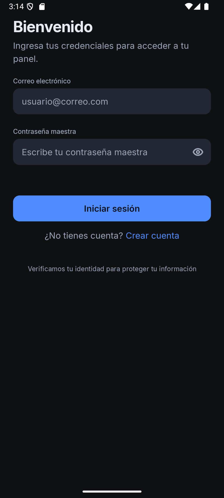
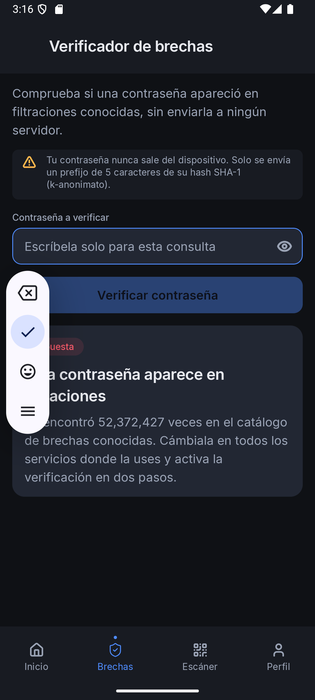
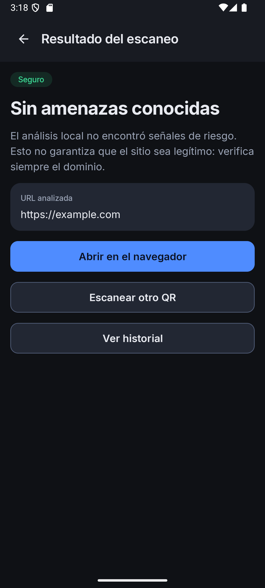
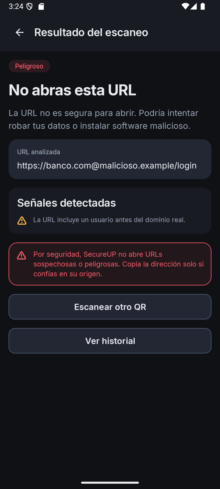
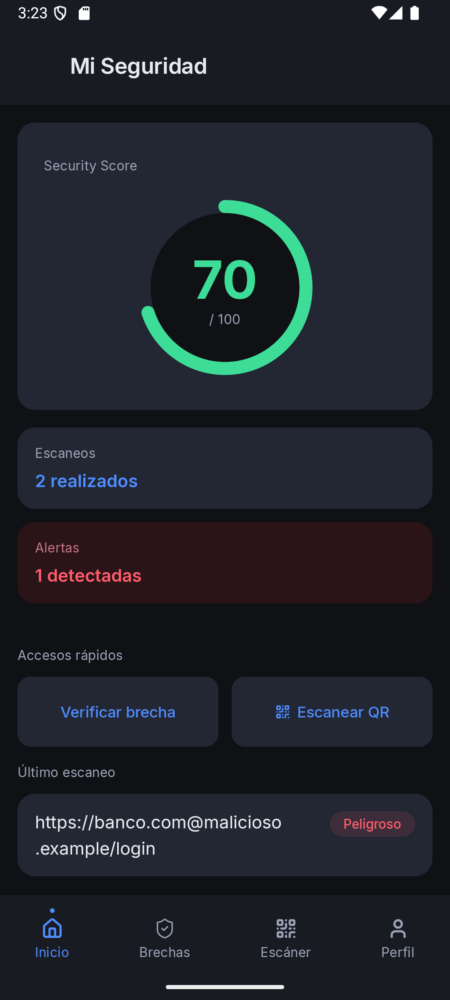
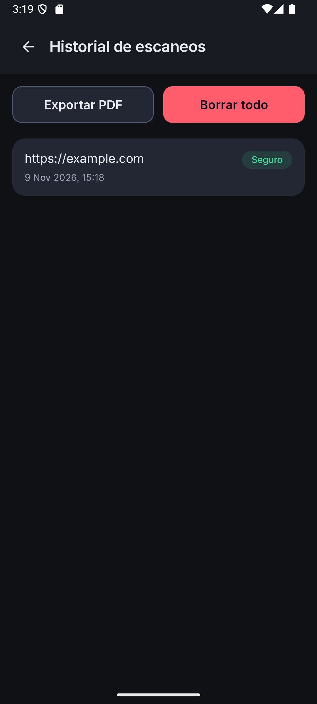
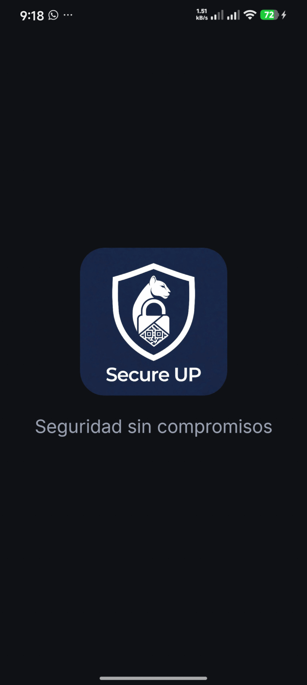

# SecureUP

Aplicación Android de seguridad digital personal: verifica contraseñas filtradas sin exponerlas, escanea códigos QR y analiza la URL antes de permitir abrirla, y guarda el historial de escaneos en el dispositivo.

Proyecto académico de **Desarrollo de Aplicaciones Móviles** (Kotlin + Jetpack Compose + MVVM).

> **Rama de trabajo:** `develop`. `main` es solo el cascarón inicial del repositorio.
> **Entrega actual:** `26.2.1` — 9 de noviembre de 2026.

---

## Estado de la entrega

| Módulo | Estado | Detalle |
| --- | --- | --- |
| Autenticación | ✅ | Registro y login con validación; repositorio simulado en memoria (el backend es un proyecto aparte) |
| Verificador de brechas | ✅ | HIBP Pwned Passwords con k-anonimato (solo se envía el prefijo SHA-1 de 5 caracteres) |
| Escáner QR | ✅ | CameraX + ML Kit, cámara o imagen de la galería, análisis local de la URL |
| Resultado del escaneo | ✅ | Veredicto seguro / sospechoso / peligroso y señales detectadas |
| Historial | ✅ | Persistencia en Room, exportación a PDF y borrado |
| Inicio | ✅ | Security Score calculado con el historial real |
| Perfil | ✅ | Cuenta de la sesión y cierre de sesión |
| Identidad visual | ✅ | Splash nativo con logo de marca e ícono de launcher definitivo |
| Bóveda de contraseñas | ⏳ | Pospuesta a la entrega `26.3.1` por decisión de alcance |
| Backend propio | ⏳ | API REST en un repositorio aparte, todavía no disponible |

## Capturas

| Login | Brecha expuesta |
| --- | --- |
|  |  |

| QR seguro | QR peligroso |
| --- | --- |
|  |  |

| Inicio (score real) | Historial | Splash |
| --- | --- | --- |
|  |  |  |

## Funcionalidades

### Verificador de brechas

- La contraseña se escribe solo para la consulta y se borra del estado al terminar.
- Se normaliza a NFC, se calcula `SHA-1` y se envían **únicamente los 5 primeros caracteres** del hash a `api.pwnedpasswords.com`.
- El resto del hash se compara localmente; la contraseña completa nunca sale del dispositivo.
- Se usa la cabecera `Add-Padding` para que el tamaño de la respuesta no revele información.
- Errores de red, servidor y respuestas inválidas se muestran con mensajes claros.

### Escáner QR

- Vista de cámara con CameraX; cada `ImageProxy` se libera siempre.
- Detección con ML Kit Barcode Scanning, en el dispositivo.
- También se puede elegir una imagen de la galería (Photo Picker, sin permisos de almacenamiento).
- `UrlAnalyzer` aplica reglas locales: esquema permitido, HTTPS, IP como host, punycode, user-info, acortadores y longitud excesiva.
- Solo las URLs **seguras** ofrecen el botón «Abrir en el navegador». Las sospechosas o peligrosas nunca se abren automáticamente.
- **Sin duplicados:** si la cámara entrega el mismo QR en varios fotogramas, se registra una sola vez en el historial.

### Historial y PDF

- Entidad `ScanHistoryEntity` en Room (versión 1, esquema exportado en `app/schemas/`).
- Exportación a PDF con `PdfDocument` y el selector de documentos del sistema (SAF), sin permisos de almacenamiento.
- Borrado completo con diálogo de confirmación.

### Inicio y perfil

- `HomeViewModel` observa Room y calcula el score: `100 − 30 × peligrosas − 10 × sospechosas`, acotado a 0–100.
- Perfil muestra el correo de la sesión, la versión y permite cerrar sesión.

## Stack

- **Kotlin** 2.2.10 · **Jetpack Compose** (BOM 2024.09.00) · **Material 3**
- **MVVM**: `ui → viewmodel → repository → Room / Retrofit`
- **Room** 2.8.5 con **KSP**
- **Retrofit** 2.12.0 + `converter-scalars`
- **CameraX** 1.6.2 · **ML Kit Barcode Scanning** 17.3.0
- `minSdk 26` · `targetSdk 35` · `compileSdk 37`
- APK debug probado en un dispositivo físico (Android 16, API 36) y en emulador (API 35)

## Arquitectura

```
Compose (ui/screens)  ──eventos──▶  ViewModel (StateFlow)  ──▶  Repository
        ▲                                                        │
        └────────────── UiState ◀───────────────────────────────┘
                                                     │
                                    ┌────────────────┴────────────────┐
                                    ▼                                 ▼
                          Room (historial QR)              Retrofit (HIBP)
```

- Las pantallas solo pintan estado y emiten eventos; no contienen red, base de datos ni criptografía.
- Cada pantalla tiene su ViewModel con un `UiState` inmutable expuesto como `StateFlow`.
- Los repositorios deciden el origen de los datos. Las operaciones de E/S corren en `Dispatchers.IO`.
- `AppGraph` (service locator) se inicializa en `SecureUpApplication` y compone las dependencias en `AppContainer`.

### Estructura de paquetes

```
com.secureup.app/
├── di/                 # AppGraph, AppContainer
├── domain/
│   ├── model/          # User, ScanRecord, ScanVerdict
│   ├── repository/     # AuthRepository, BreachRepository, ScanHistoryRepository
│   └── security/       # UrlAnalyzer
├── data/
│   ├── local/          # Room: entidad, DAO, base de datos
│   ├── remote/         # HibpApi, NetworkModule
│   ├── repository/     # implementaciones + SessionManager
│   ├── scanner/        # QrCodeReader (ML Kit para galería)
│   ├── export/         # ScanHistoryPdfWriter
│   └── crypto/         # CryptoManager (entrega anterior)
├── viewmodel/          # Auth, Breach, Scanner, ScanResult, Home, History, Profile
└── ui/
    ├── screens/        # una pantalla por archivo
    ├── components/     # botones, campos, badges, barras, tarjetas
    ├── navigation/     # NavHost y rutas
    └── theme/          # tokens de DESIGN.md
```

## Seguridad

- La contraseña maestra nunca se guarda ni se envía; solo vive en memoria durante la sesión.
- El vault (entrega siguiente) usa `PBKDF2WithHmacSHA256` + HKDF-Expand de un bloque y `AES-256-GCM` con nonce aleatorio de 12 bytes; el AAD es el UUID de la entrada.
- HIBP se consulta directamente desde la app porque **no requiere API key**; el k-anonimato limita la petición al prefijo del hash.
- `android:allowBackup="false"`, un solo componente exportado (el launcher), permisos mínimos (`INTERNET`, `CAMERA` en tiempo de ejecución) y `usesCleartextTraffic="false"`.
- Sin logs de contraseñas, hashes, tokens ni contenido de peticiones.
- URLs de QR tratadas como no confiables: se muestra siempre la URL completa y nunca se abre automáticamente.

## Compilar y probar

Requisitos: JDK 17 o superior, Android SDK con API 37 y un dispositivo/emulador con API 26+.

```powershell
# Compilar APK debug
.\gradlew assembleDebug
# APK: app/build/outputs/apk/debug/app-debug.apk

# Pruebas unitarias (71 pruebas)
.\gradlew testDebugUnitTest

# Análisis estático
.\gradlew lintDebug
```

Resultado de la última verificación: **71 pruebas, 0 fallos** y **lint 0 errores, 22 advertencias**.

## Alcance y limitaciones

- **No hay backend propio todavía.** El login usa `FakeAuthRepository`; el registro y la sesión viven en memoria. El contrato que debe cumplir la API está en [BACKEND.md](BACKEND.md). La bóveda, el cambio de contraseña maestra y la eliminación de cuenta quedan para `26.3.1`.
- La verificación de URLs es **heurística local** (`UrlAnalyzer`), no un servicio de reputación. Safe Browsing requiere un proxy en el backend y está pendiente.
- La pestaña inferior «Bóveda» se sustituyó temporalmente por «Brechas» para esta entrega; se restaura cuando exista la bóveda.
- El score del Inicio se calcula solo con escaneos; la parte de fortaleza de contraseñas de la bóveda llegará con ella.
- El historial se guarda sin cifrar en la base local porque solo contiene URLs y veredictos, no credenciales.

## Documentación

- [Reporte técnico (HTML)](docs/REPORTE_TECNICO.html) · [PDF](docs/REPORTE_TECNICO.pdf)
- [Contrato del backend](BACKEND.md)
- [Diseño y tokens](DESIGN.md)
- [Reglas del proyecto](AGENTS.md)

## Repositorio

- `main`: cascarón inicial (estructura, documentación y configuración).
- `develop`: rama de integración; todo cambio llega por Pull Request desde `feature/*`.
- Releases: la versión estable se etiqueta como `vAA.M.m` desde `develop`.
